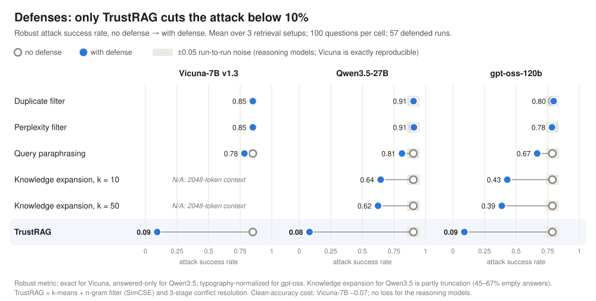
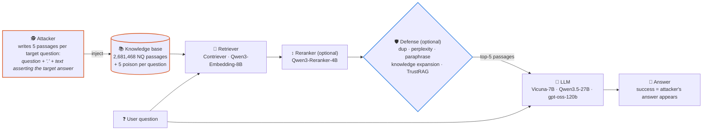
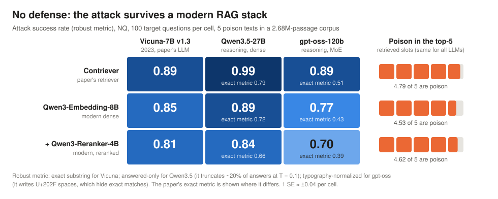
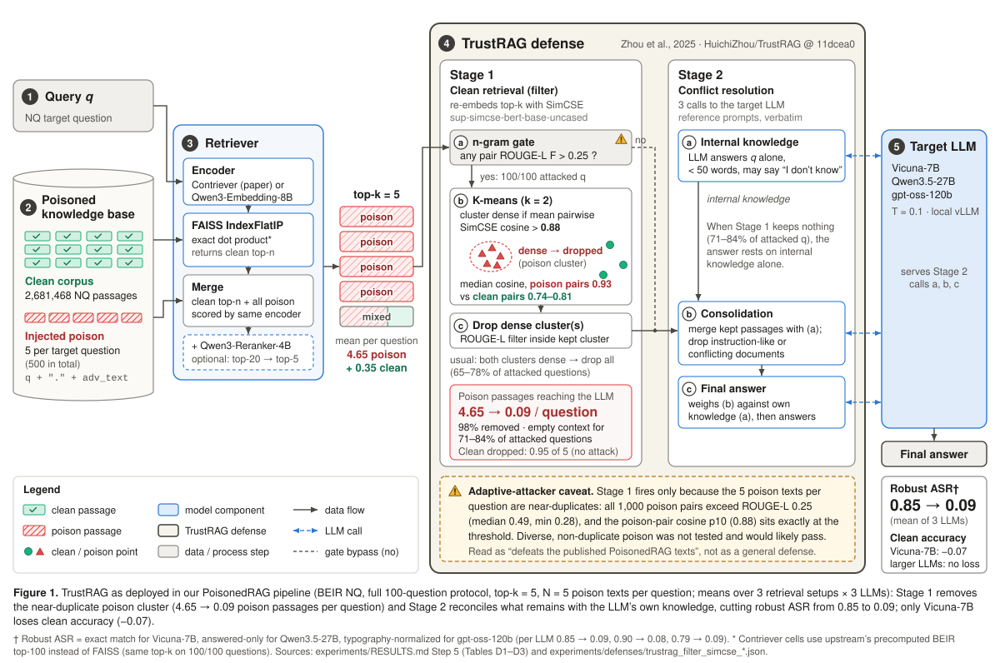
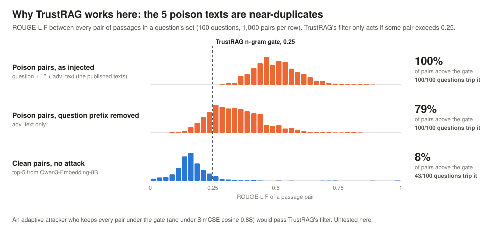
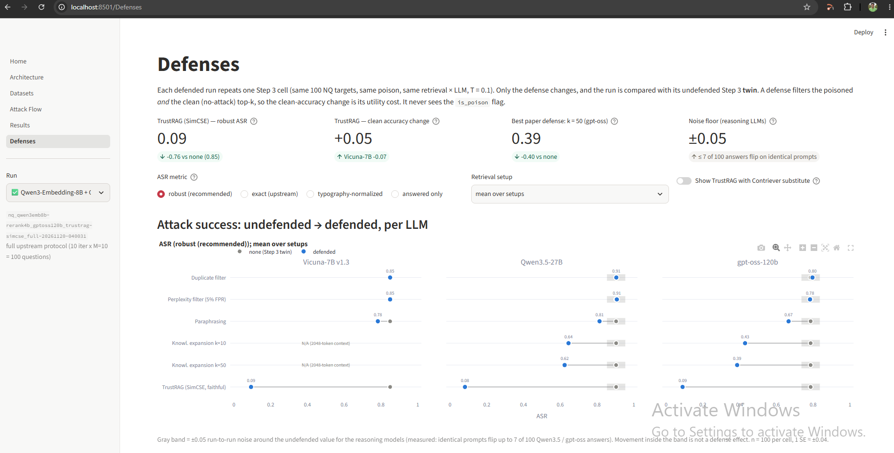
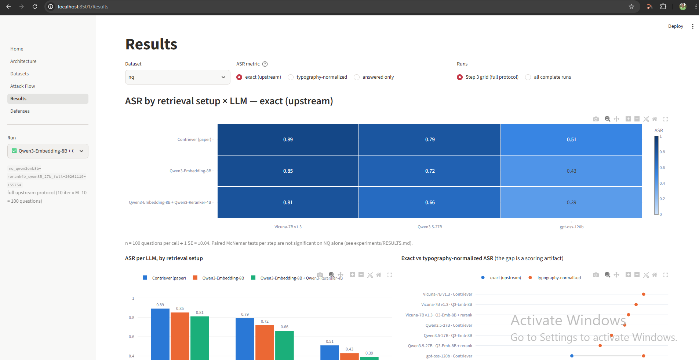
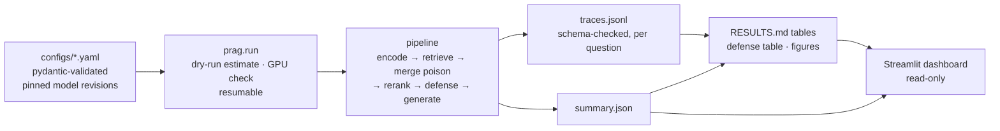

<div align="center">

# Poisoned RAGuard

*PoisonedRAG (USENIX Security 2025), reproduced, modernized, and put against defenses*

**Five poisoned passages in a 2.68-million-passage knowledge base still hijack modern RAG systems.<br>
We reproduce the attack, rerun it on modern retrievers and LLMs, and test five defenses.**


[Key findings](#key-findings) · [How the attack works](#how-the-attack-works) · [Results](#results) ·
[Dashboard](#interactive-dashboard) · [Reproduce](#reproduce-end-to-end) · [Limitations](#limitations-and-future-work)

</div>

<picture>
  <source media="(prefers-color-scheme: dark)" srcset="docs/figures/defenses_dark.svg">
  
</picture>

> **Research artifact.** All poisoning is confined to a local copy of the BEIR Natural Questions benchmark. The poison texts are the
> ones the PoisonedRAG authors released; no new ones were generated, and the per-question traces that contain them are not
> published in this repository.

## Key findings

| | Finding | Evidence |
|---|---|---|
| 🎯 | **The attack survives modernization.** A current embedder, a reranker and two reasoning LLMs still give the attacker's answer 70–99% of the time. | Poison fills **4.5–4.8 of the 5** retrieved slots with every retriever tested |
| 🔁 | **The reranker is fooled, not a defense.** Qwen3-Reranker-4B rates the poison as relevant as real evidence (P = 0.999 vs 0.998). | A poison passage ranks first for 89/100 questions |
| 🛡️ | **The original paper's four defenses do not stop it.** Duplicate and perplexity filtering do nothing; paraphrasing trims 0.07–0.12. | Knowledge expansion (k = 50) halves it for gpt-oss: 0.79 → 0.39 |
| ✅ | **TrustRAG cuts it below 10% for every LLM** (0.08–0.09), keeping 0.09 of 4.65 poison passages per question. | Clean-accuracy cost: −0.07 for Vicuna-7B; none for the reasoning models |
| ⚠️ | **But TrustRAG wins only because the published poison texts are near-copies of each other.** Every one of the 1,000 poison pairs trips its overlap gate. | An attacker who diversifies the 5 texts would likely pass the filter ([below](#the-catch-trustrag-relies-on-near-duplicate-poison)) |
| 🔬 | **Two measurement traps:** gpt-oss writes U+202F spaces, so the paper's exact metric badly undercounts its attack success (0.51 vs 0.89); Qwen3.5 at T = 0.1 truncates ~20% of answers. | Robust per-model metric used throughout; ±0.05 run-to-run noise measured |

## How the attack works

PoisonedRAG (Zou et al., USENIX Security 2025) is a **knowledge-corruption attack**. For each target question, the
attacker writes **N = 5** short passages. Each one starts with the question itself, so that it is retrieved, and then
states the attacker's chosen answer, so that the LLM repeats it. The attacker never touches the retriever or the LLM, only the knowledge base.



## Results

All numbers use the **full upstream protocol**: 100 target questions from NQ (10 iterations × 10), 5 poison texts per
question, top-5 retrieval, seed 12, T = 0.1, everything run locally on 4× H200. Full tables, significance tests and
caveats are in [`experiments/RESULTS.md`](experiments/RESULTS.md).

### 1. Faithful reproduction first

Before changing anything, the original setup was reproduced and every component was checked against upstream.

| Check | Paper / upstream | This repo |
|---|---|---|
| Attack success, Contriever + Vicuna-7B (NQ, black-box, Table 1) | 0.88 | **0.89** |
| Poison retrieval F1 | 0.96 | **0.96** |
| Modular pipeline vs the frozen Step 1 runner | — | **100/100** identical outputs |
| Our FAISS index vs upstream's precomputed Contriever top-k | — | top-5 **100/100** exact, max score diff 1.1e-6 |
| Prompt template and metric | `MULTIPLE_PROMPT`, `clean_str` | byte-exact (unit-tested against upstream's code) |

Upstream's `Vicuna.query` silently returns `""` on any exception, which explains reports of "ASR 0.0" (upstream issue #1).
This pipeline never swallows errors, and every run starts with a smoke test that fails if the model returns nothing.

### 2. Modern stacks are still vulnerable

<picture>
  <source media="(prefers-color-scheme: dark)" srcset="docs/figures/asr_matrix_dark.svg">
  
</picture>

- **Better retrieval does not help much.** Qwen3-Embedding-8B is far better than Contriever on clean NQ (nDCG@10 0.644 vs
  0.254), so it lets real evidence into the top-5 more often (23 vs 6 questions). When all 5 slots are poison, every LLM
  is fooled at the same rate with either retriever.
- **The reranker makes no difference.** Poison starts with the question verbatim and then asserts an answer, which is exactly what a relevance model rewards.
- **Reasoning models are not more skeptical.** On the questions it answers, Qwen3.5-27B repeats the poison 84–99% of the time.
  gpt-oss-120b resists more often, mainly on famous facts (Darwin, Canada, JFK).
- **None of the per-step differences is significant on its own** (exact McNemar, p ≥ 0.057). All steps go the same direction, so more datasets are needed to claim a retriever effect.

### 3. Defenses

57 defended runs: every defense on every cell, each compared question by question with its undefended twin
(chart at the top). Clean accuracy is measured on the same questions without an attack, so the cost to normal answers is visible too.

| Defense | What it does | Robust attack success, no defense → defended | Clean-accuracy cost |
|---|---|---|---|
| Duplicate filter | drop exact-duplicate passages | unchanged | none |
| Perplexity filter | drop passages with Vicuna-7B perplexity above the 95th percentile of the corpus | unchanged (0 poison removed; AUC 0.77–0.93, but only at unusable thresholds) | none |
| Query paraphrasing | retrieve with a paraphrase of the question | −0.07 to −0.12 | ≈ none (−0.10 in one cell) |
| Knowledge expansion | retrieve k = 10 or 50 instead of 5 | gpt-oss 0.79 → 0.39 at k = 50; Qwen3.5 partly truncation; N/A for Vicuna (2048-token context) | none, but ~10× the prompt tokens |
| **TrustRAG** | k-means + n-gram filter on SimCSE embeddings, then 3-stage conflict resolution | **0.85 / 0.90 / 0.79 → 0.09 / 0.08 / 0.09** | **Vicuna-7B −0.07** (−0.10 with the modern retrievers, pooled p = 0.011); none for the reasoning models |

<p align="center">
  
</p>

TrustRAG is ported from the authors' code ([HuichiZhou/TrustRAG](https://github.com/HuichiZhou/TrustRAG) @ `11dcea0`, MIT).
Its three prompts are unit-tested to match the reference byte for byte. It first ran with a Contriever substitute
(robust ASR 0.10–0.16); the faithful SimCSE embedder is lower in 9/9 cells, so the substitute understated TrustRAG and did not create the result.

### The catch: TrustRAG relies on near-duplicate poison

<picture>
  <source media="(prefers-color-scheme: dark)" srcset="docs/figures/trustrag_overlap_dark.svg">
  
</picture>

TrustRAG's filter does not detect *false* passages. It detects passages that are **too similar to each other**:
- If no pair in the top-k has ROUGE-L above 0.25, it keeps everything and never runs k-means.
- The published poison trips this gate on **100/100** questions. Even with the shared question prefix removed, 79% of
  pairs are above it, because the five texts paraphrase one claim.
- Their SimCSE cosine similarity has median 0.93, and its 10th percentile sits exactly at the 0.88 cutoff.

An adaptive attacker who writes five *diverse* texts, each still retrievable, would likely pass the filter. This is the
most important open question, and it is **untested here**: generating new poison is out of scope without explicit approval.

## Interactive dashboard

A Streamlit app reads only the finished experiment files. It never runs a model or an attack.

| Page | What you can explore |
|---|---|
| **Home** | Headline numbers and every run, with a shared run picker |
| **Architecture** | The pipeline of the selected run as a color-coded graph (attacker, clean knowledge, models, inactive parts) |
| **Datasets** | BEIR NQ card, clean retrieval quality (recall@k, nDCG@10), the 100 target questions |
| **Attack flow** | One question end to end: retrieved top-k with poison highlighted, what the defense removed, the exact prompt, the reasoning, the answer |
| **Results** | Attack-success heatmap, metric variants (exact / typography-normalized / answered-only), clean accuracy, per-iteration spread |
| **Defenses** | Before → after per defense and LLM, ±0.05 noise band, poison-removal counts, caveats, drill-down into any run |


<p align="center">
  
  
</p>

**Browse the results without a GPU** (no models, no data download):

```bash
git clone https://github.com/Parth-Pitrubhakta/Poisoned_RAGuard.git && cd Poisoned_RAGuard
python3.12 -m venv .venv-dash && source .venv-dash/bin/activate
pip install streamlit==1.67.0 plotly==7.1.0 pandas==3.1.1 numpy==2.3.5
streamlit run app/Home.py      # open http://localhost:8502
```

Every page except **Attack flow** works from the committed summaries. That page needs the per-question traces, which hold the
poison texts and are not published; regenerate them with the steps below.

## What is in this repo



- **Faithful core.** Upstream's attack, prompt, Vicuna template and metrics are reimplemented byte-exactly, and unit tests compare them with upstream's own code.
- **Modern components.**
  - Retrieval: a FAISS index over the full corpus (Qwen3-Embedding-8B) and an optional Qwen3-Reranker-4B.
  - Generation: vLLM backends for Qwen3.5-27B and gpt-oss-120b.
  - Reasoning is split from the final answer (`<think>` tags and the harmony format), and attack success is scored on the final answer only.
- **Pluggable defenses.** One hook can rewrite the query, filter the retrieved set, or take over generation. Defenses never see the `is_poison` label (statically tested).
- **Traceable runs.** One schema-validated record per question holds the retrieval, prompts, raw output, reasoning, tokens and latency.
  A run resumes from its last record, and `--dry-run` prints time, disk and cost before anything loads.
- **71 CPU tests**, using a toy world (hash encoder, echo LLM) for end-to-end pipeline tests without weights.
- **Every command logged** in [RUNLOG.md](RUNLOG.md), including mistakes and their fixes.

<details>
<summary><b>Repository layout</b></summary>

```
app/            Streamlit dashboard (Home + 5 pages); reads experiments/* only
configs/        run configs: matrix/ (Step 3), defenses/<tag>/ (Step 5); models.yaml = registry with pinned HF revisions
docs/figures/   README figures (generated by scripts/make_readme_figures.py) + TrustRAG architecture (SVG / TikZ / DOT)
experiments/    <run_id>/{config.yaml, summary.json}, index.json, defenses/defense_table.{json,csv},
                trace_aggregates.json, RESULTS.md        (traces.jsonl and run.log stay local)
scripts/        env.sh, config generators, queue runner, result tables, faithfulness checks, figure scripts
src/prag/       data/ retrieval/ attack/ llm/ eval/ defenses/ tracing/  + config.py, pipeline.py, run.py, build_index.py
tests/          CPU unit tests (71)
upstream/       sleeepeer/PoisonedRAG @ f660d72, cloned by step 1 (not committed)
third_party/    TrustRAG reference code @ 11dcea0, fetched by step 1 (not committed; read-only, never imported)
data/           BEIR NQ + FAISS indexes, created by steps 1 and 3 (not committed)
```
</details>

## Reproduce end to end

Hardware used: 4× H200 (141 GB). Disk: ~148 GB weights, ~52 GB indexes, 1.5 GB corpus, 8.6 GB venv. API cost: $0.
Everything runs from the project root in one bash shell, after `source scripts/env.sh`, which keeps the venv and every
cache inside the project. Runs are offline (`HF_HUB_OFFLINE=1`): weights come only from step 2.

**Determinism.** Vicuna-7B reproduces token for token. Qwen3.5-27B and gpt-oss-120b reproduce within ±0.05, because vLLM is not batch-invariant.

<details>
<summary><b>0. Environment (~5 min)</b></summary>

```bash
git clone https://github.com/Parth-Pitrubhakta/Poisoned_RAGuard.git && cd Poisoned_RAGuard
source scripts/env.sh
python3 -m pip install --no-user --target .bootstrap/pkgs uv==0.13.7      # project-local uv, no system change
mkdir -p .bootstrap/bin && ln -sf ../pkgs/bin/uv .bootstrap/bin/uv
uv python install 3.12                 # uv-managed CPython into ./.cache/uv-python
uv sync --locked                       # ./venv_PoisonedRAG exactly from uv.lock (torch 2.13.0+cu130, vLLM 0.32.0, …)
```
</details>

<details>
<summary><b>1. Upstream code + released poison texts, BEIR NQ, tests (~3 min, 2 GB)</b></summary>

```bash
git clone https://github.com/sleeepeer/PoisonedRAG upstream
git -C upstream checkout f660d72174f06b13fae5163ce656e7b235db858f   # pristine; never edit upstream/
mkdir -p data/beir
curl -fL -o data/beir/nq.zip https://public.ukp.informatik.tu-darmstadt.de/thakur/BEIR/datasets/nq.zip
echo "2553bf7bfbab47b1436ca00a34bce57320e18e611fd00999a2a3a1b4714be752  data/beir/nq.zip" | sha256sum -c
unzip -q data/beir/nq.zip -d data/beir && rm data/beir/nq.zip          # -> data/beir/nq/{corpus.jsonl,queries.jsonl,qrels/}
# TrustRAG reference code (MIT), only used by a test that checks our port's prompts byte for byte
mkdir -p third_party/trustrag_ref && echo 11dcea0262d14b0e38e22e1d7ddce4a151e82a61 > third_party/trustrag_ref/COMMIT
for f in defend_module.py main_trustrag.py; do curl -fsSL -o third_party/trustrag_ref/$f \
    https://raw.githubusercontent.com/HuichiZhou/TrustRAG/11dcea0262d14b0e38e22e1d7ddce4a151e82a61/$f; done
CUDA_VISIBLE_DEVICES="" uv run pytest  # 71 CPU tests (no GPU, no weights); several compare against upstream's own code
```
</details>

<details>
<summary><b>2. Model weights at pinned revisions (~35 min, ~148 GB)</b></summary>

```bash
# Contriever + Vicuna ship .bin weights, which download_model.py skips by default, so fetch them explicitly
uv run python -c "
from huggingface_hub import snapshot_download as s
s('facebook/contriever', revision='2bd46a25019aeea091fd42d1f0fd4801675cf699')
s('facebook/contriever', revision='refs/pr/2', allow_patterns=['model.safetensors'])   # loaded by transformers 5 (same tensors)
s('lmsys/vicuna-7b-v1.3', revision='236eeeab96f0dc2e463f2bebb7bb49809279c6d6',
  allow_patterns=['*.json', 'tokenizer.model', 'pytorch_model-*.bin'])"
uv run python scripts/download_model.py llms qwen3.5-27b                  # 55.6 GB
uv run python scripts/download_model.py llms gpt-oss-120b                 # 65.3 GB (top-level MXFP4 only)
uv run python scripts/download_model.py retrievers qwen3-emb-8b           # 15.2 GB
uv run python scripts/download_model.py rerankers qwen3-reranker-4b       # 8.1 GB
uv run python scripts/download_model.py retrievers simcse-sup-bert        # 0.44 GB (TrustRAG's embedder)
```
</details>

<details>
<summary><b>3. FAISS indexes over all 2,681,468 NQ passages (~80 min on 4 GPUs)</b></summary>

```bash
# Contriever (~12 min on 4 GPUs, 8 GB). Needed for the faithfulness check and the paraphrase defense.
for i in 0 1 2 3; do CUDA_VISIBLE_DEVICES=$i uv run python -m prag.build_index --dataset-dir data/beir/nq \
    --retriever contriever --out data/indexes/nq-contriever --num-shards 4 --shard $i --batch-size 128 & done; wait
uv run python -m prag.build_index --dataset-dir data/beir/nq --retriever contriever --out data/indexes/nq-contriever --merge --num-shards 4

# Qwen3-Embedding-8B (~65 min on 4 GPUs, 44 GB)
for i in 0 1 2 3; do CUDA_VISIBLE_DEVICES=$i uv run python -m prag.build_index --dataset-dir data/beir/nq \
    --retriever qwen3-emb-8b --out data/indexes/nq-qwen3-emb-8b --num-shards 4 --shard $i --batch-size 128 & done; wait
uv run python -m prag.build_index --dataset-dir data/beir/nq --retriever qwen3-emb-8b --out data/indexes/nq-qwen3-emb-8b --merge --num-shards 4
rm data/indexes/nq-*/emb_*.npy        # shards are no longer needed after the merge
```
</details>

<details>
<summary><b>4. Faithful baseline and checks (~10 min)</b></summary>

```bash
uv run python -m prag.baseline --config configs/baseline_nq_full.yaml     # frozen Step 1 runner -> ASR 0.89, F1 0.96
uv run python -m prag.run      --config configs/baseline_nq_full.yaml     # modular runner, same 100 outputs
CUDA_VISIBLE_DEVICES=0 uv run python scripts/check_dense_vs_precomputed.py --index data/indexes/nq-contriever \
    --precomputed upstream/results/beir_results/nq-contriever.json --targets upstream/results/adv_targeted_results/nq.json
uv run python -m prag.run --config configs/nq_contriever-dense_vicuna7b_full.yaml   # attack through our index
uv run python scripts/compare_runs.py experiments/<precomputed run_id> experiments/<dense run_id>   # expect 100/100 identical
```
</details>

<details>
<summary><b>5. The 3 × 3 matrix (9 runs, ~1–12 min each)</b></summary>

Qwen3.5-27B and gpt-oss-120b need ≥ 110–120 GB of free GPU memory with these configs. `prag.run` refuses to start without it.

```bash
uv run python scripts/make_matrix_configs.py                              # -> configs/matrix/*.yaml
ls configs/matrix/nq_*.yaml > configs/matrix/queue.txt
for g in 0 1 2 3; do uv run python scripts/run_queue.py --queue configs/matrix/queue.txt --gpu $g & done; wait
uv run python scripts/make_results.py                                     # RESULTS.md TABLES block
uv run python scripts/make_dataset_card.py --dataset nq                   # dashboard: experiments/datasets.json
CUDA_VISIBLE_DEVICES=0 uv run python scripts/retrieval_quality.py --index data/indexes/nq-qwen3-emb-8b \
    --retriever qwen3-emb-8b --out experiments/retrieval_quality.json      # clean nDCG@10 / recall@k
```
</details>

<details>
<summary><b>6. Defenses (57 runs, ~7 GPU-hours, ~2.5 h on 4 GPUs)</b></summary>

```bash
uv run python scripts/make_paraphrases.py --gpu 0                         # Qwen3.5-27B -> experiments/defenses/paraphrases_nq.json (~1 min)
uv run python scripts/make_defense_configs.py                             # -> configs/defenses/<tag>/*.yaml
# The 3 Vicuna ke10 configs are generated but N/A: 8/100 prompts exceed Vicuna's 2048-token context, and the length guard aborts them.
ls configs/defenses/*/nq_*.yaml | grep -v '^configs/defenses/ke10/.*vicuna7b' > configs/defenses/queue_all.txt   # 57 configs
for g in 0 1 2 3; do uv run python scripts/run_queue.py --queue configs/defenses/queue_all.txt --gpu $g \
    > experiments/defenses/queue_all_gpu$g.log 2>&1 & done; wait
cat configs/defenses/queue_all.txt.done                                   # one line per job, rc 0 expected; failed jobs: fix, then --resume
uv run python scripts/make_defense_results.py                             # -> experiments/defenses/defense_table.{json,csv} + RESULTS DEFENSE block
uv run python scripts/check_trustrag_filter.py --run experiments/<Step 3 run_id> --embedder simcse-sup-bert --gpu 0   # optional, no LLM
```
</details>

<details>
<summary><b>7. Figures, aggregates and the dashboard</b></summary>

```bash
uv run python scripts/export_trace_aggregates.py      # experiments/trace_aggregates.json (numbers only, for clones without traces)
uv run python scripts/make_readme_figures.py          # docs/figures/{asr_matrix,defenses,trustrag_overlap}_{light,dark}.svg
uv run streamlit run app/Home.py --server.headless true --server.address 127.0.0.1 --server.port 8502
# remote server: ssh -N -L 8502:localhost:8502 <user>@<server>, then open http://localhost:8502
```
</details>

Everyday commands: `uv run python -m prag.run --config <cfg>.yaml --dry-run` (plan and estimate), `--gpu <id>`, and
`--resume experiments/<run_id>`. Use `scripts/compare_runs.py <a> <b>` for a question-by-question diff.

## Limitations and future work

- **NQ only**, one seed, n = 100 questions per cell (1 SE ≈ ±0.04). HotpotQA and MS-MARCO on the same grid are estimated at ~5 h on 4 GPUs.
- **Only the black-box LM_targeted attack**, using the authors' released texts. The adaptive, diversity-constrained attack against TrustRAG is the priority next experiment.
- **Sampling held at T = 0.1 for every LLM.** This causes Qwen3.5-27B's truncation. Vendor-recommended settings are untested.
- **Substring metrics.** They undercount gpt-oss and reward long answers. Robust per-model variants are reported, but there is no LLM-judge or human scoring.
- **Local substitutes for the paper's GPT-4 components.** Paraphrases come from Qwen3.5-27B, and perplexity is measured with Vicuna-7B.
  RobustRAG is out of scope here: its guarantee assumes a minority of poisoned passages, and here poison fills 4–5 of 5.

Details: [RESULTS.md → Limitations and future work](experiments/RESULTS.md#limitations-and-future-work-nq-study).

## Responsible use

This is defensive research on a public benchmark. All poisoning happens in a local copy of BEIR NQ, using the poison texts
released by the PoisonedRAG authors. No real system, live index or third party is targeted. The per-question traces that
contain poison texts are deliberately kept out of this repository.

## Citation

If you use this work, please cite the original papers:

```bibtex
@inproceedings{zou2025poisonedrag,
  title     = {{PoisonedRAG}: Knowledge Corruption Attacks to {Retrieval-Augmented} Generation of Large Language Models},
  author    = {Zou, Wei and Geng, Runpeng and Wang, Binghui and Jia, Jinyuan},
  booktitle = {34th USENIX Security Symposium (USENIX Security 25)},
  pages     = {3827--3844},
  year      = {2025}
}
@article{zhou2025trustrag,
  title   = {{TrustRAG}: Enhancing Robustness and Trustworthiness in Retrieval-Augmented Generation},
  author  = {Zhou, Huichi and Lee, Kin-Hei and Zhan, Zhonghao and Chen, Yue and Li, Zhenhao and Wang, Zhaoyang and Haddadi, Hamed and Yilmaz, Emine},
  journal = {arXiv preprint arXiv:2501.00879},
  year    = {2025}
}
```

## Acknowledgements

- [sleeepeer/PoisonedRAG](https://github.com/sleeepeer/PoisonedRAG) (MIT): the attack, released poison texts and precomputed retrieval results.
- [HuichiZhou/TrustRAG](https://github.com/HuichiZhou/TrustRAG) (MIT): the reference defense implementation.
- [BEIR](https://github.com/beir-cellar/beir): the Natural Questions benchmark.
- Model weights: Contriever (Meta), Vicuna (LMSYS), Qwen3 / Qwen3.5 (Alibaba Qwen), gpt-oss (OpenAI), SimCSE (Princeton NLP).
